<div align="center">

# Kelvin

### Write a *sentence*. Ship *firmware*.

**A hand-written C++17 compiler for IoT automation rules, with an AI front end that the compiler double-checks.**

[](https://github.com/sanjay7978/ai-iot-dsl-compiler/actions/workflows/ci.yml)


%2C_0_conflicts-ff6a2b)

[](LICENSE)

[Quick start](#quick-start) · [How it works](#how-it-works) · [Screenshots](#a-tour) · [Results](#results) · [Docs](docs/DESIGN.md) · [Paper](docs/paper/Review_III_Manuscript.pdf)

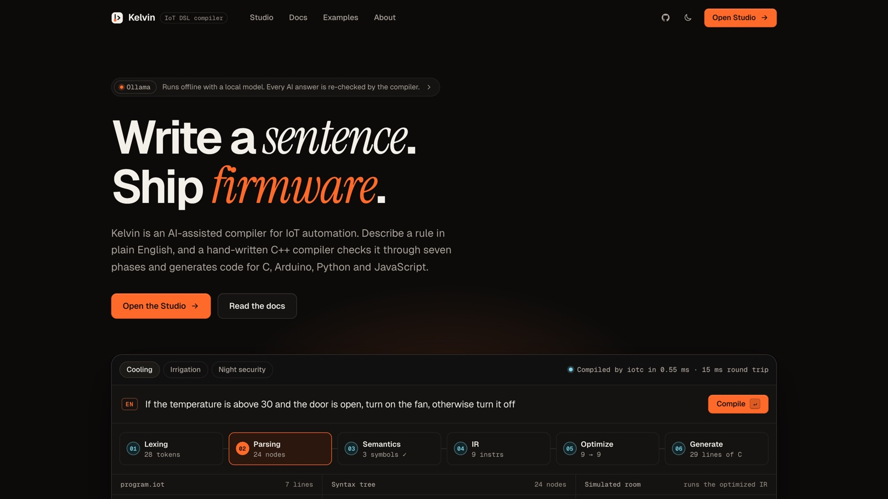

</div>

---

## What is it?

Programming a smart device usually means writing C by hand for a rule as simple as *"if it's hotter than 30 and the door is open, turn on the fan"*. Kelvin turns that rule into checked, optimized code for **C, Arduino/ESP32, Python and JavaScript**.

```
SENSOR temperature : NUMBER
SENSOR door : STATE
DEVICE fan

IF temperature > 30 AND door == OPEN
THEN turn_on(fan)
```

You can write the rule in this small language, or **type it in plain English** and let a local AI model draft it. Either way, every line goes through a compiler we wrote from scratch: no Lex, no Yacc, no parser generators, no compiler libraries.

### Highlights

- **All seven classic compiler phases**, hand-written: a DFA lexer, an LL(1) recursive-descent parser, an AST, semantic analysis, three-address code, a CFG-based optimizer, and multi-target code generation.
- **It finds logic bugs, not just syntax errors.** Rule analysis converts conditions to disjunctive normal form and reports impossible conditions, always-true conditions, dead `ELSE IF` branches, and **two rules fighting over the same device**, with a concrete example of when it happens.
- **A real optimizer:** liveness and available-expressions dataflow analysis drive 8 passes that run to a fixpoint. The optimization example shrinks from **21 to 10 instructions**.
- **AI proposes, the compiler decides.** English is turned into DSL by a local model (Ollama), Groq or Gemini, then checked for compilation *and* meaning, with one compiler-guided repair and an offline fallback. Accuracy rises from **90.0% to 96.7%**, and **100%** of outputs compile.
- **You can watch it compile.** The web Studio replays the DFA and the parser step by step, shows every optimizer pass in a "time machine", runs the output in a smart-home digital twin, and lets a phone act as the sensor remote.
- **Runs fully offline.** The Python server uses the standard library only, the web UI has no frameworks, and the fonts are bundled.

---

## A tour

<table>
<tr>
<td width="50%">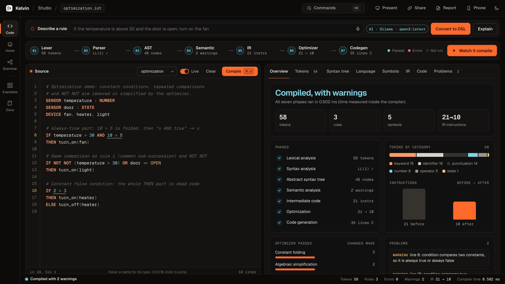<br><sub><b>Studio.</b> Editor, seven-phase status strip, and a summary of the last compile.</sub></td>
<td width="50%">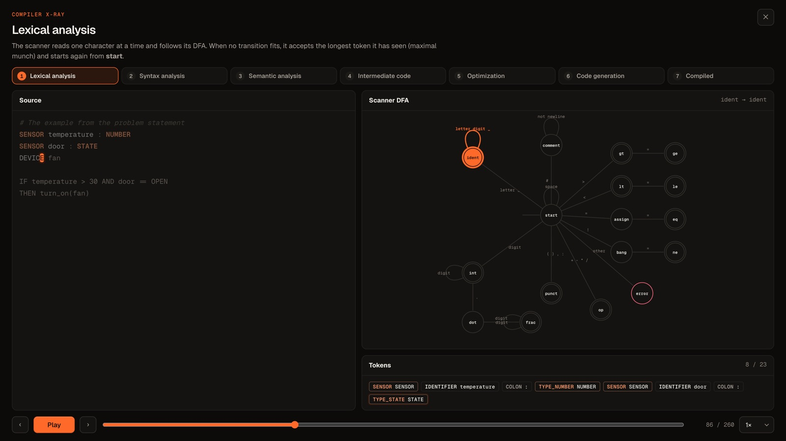<br><sub><b>Compiler X-ray.</b> The scanner DFA moving character by character, replayed from the real compiler trace.</sub></td>
</tr>
<tr>
<td>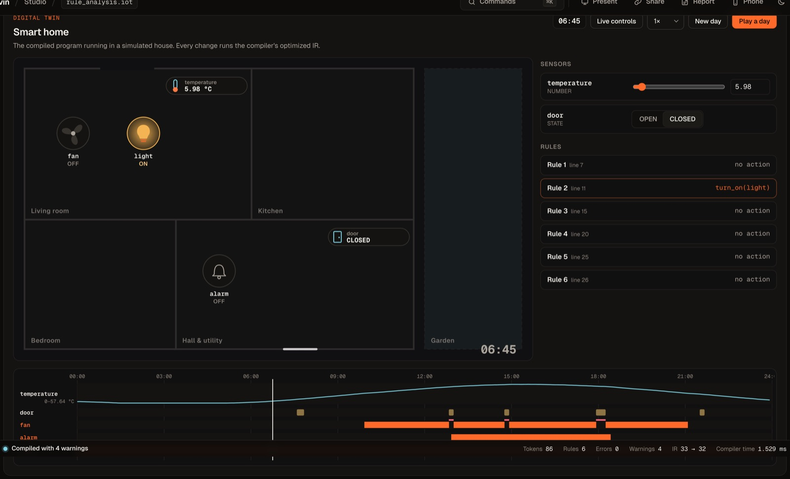<br><sub><b>Digital twin.</b> The optimized program running in a simulated house; <i>Play a day</i> simulates 24 hours.</sub></td>
<td>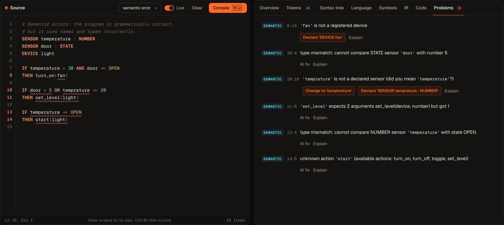<br><sub><b>Errors that help.</b> Every error at once, with <i>did you mean…</i> and one-click quick fixes.</sub></td>
</tr>
<tr>
<td>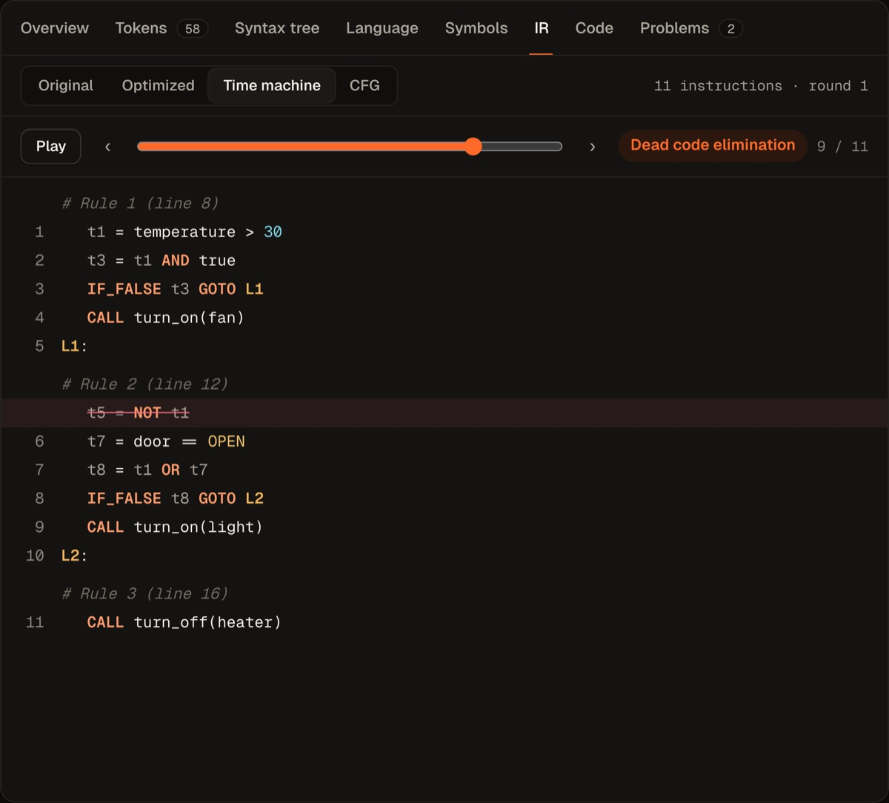<br><sub><b>Optimizer time machine.</b> Step through each pass and see what it removed.</sub></td>
<td>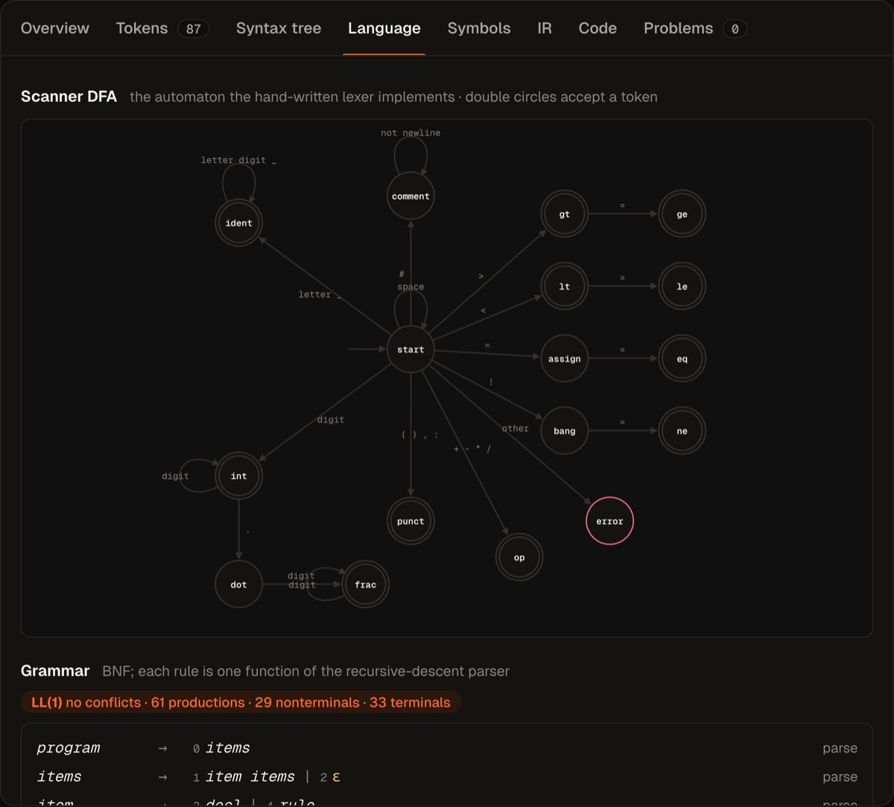<br><sub><b>Language tab.</b> The DFA, grammar, FIRST/FOLLOW sets and LL(1) table, all computed by the compiler itself.</sub></td>
</tr>
</table>

<details>
<summary><b>More screenshots</b></summary>
<br>

| Live demo on the home page | Generated C, built and run |
|---|---|
| 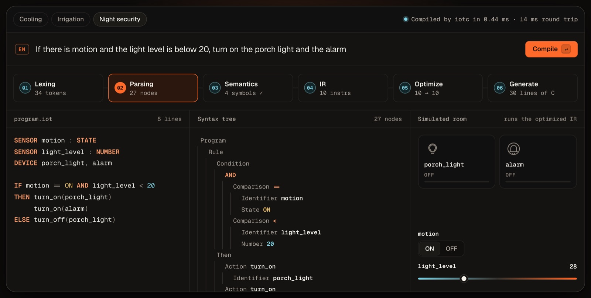 | 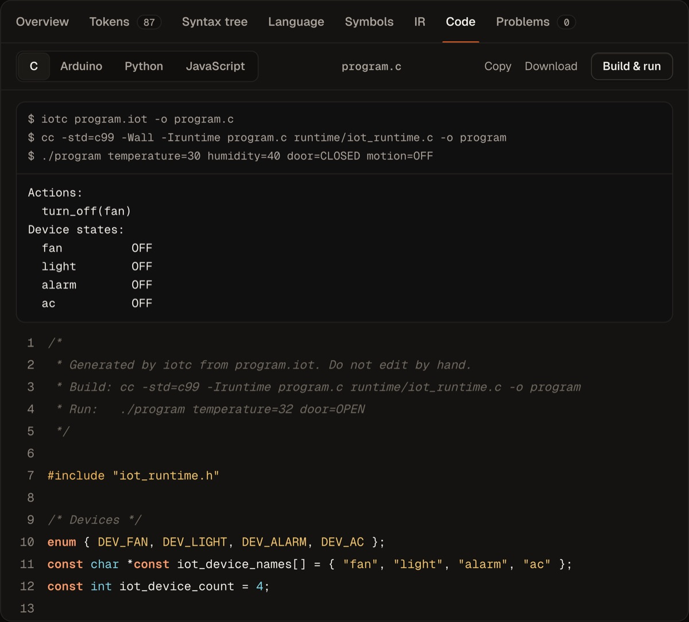 |

| Control-flow graph |
|---|
| 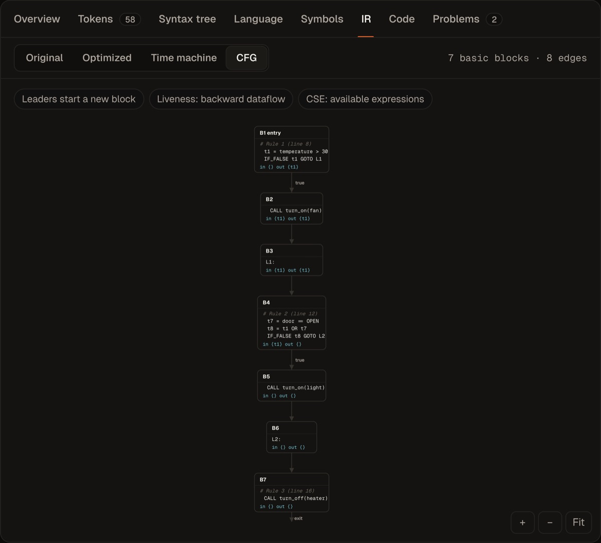 |

</details>

---

## How it works

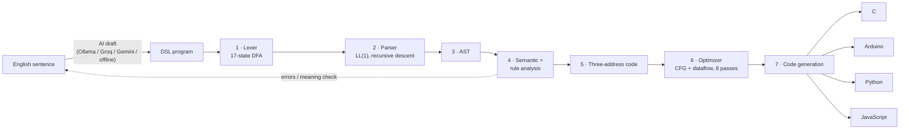

| # | Phase | Source | What it does |
|---|---|---|---|
| 1 | Lexical analysis | [`lexer.cpp`](src/lexer.cpp) | 17-state DFA with longest match; every token keeps its line:column |
| 2 | Syntax analysis | [`parser.cpp`](src/parser.cpp), [`grammar.cpp`](src/grammar.cpp) | 61-production LL(1) grammar (0 conflicts, proven by computed FIRST/FOLLOW sets); panic-mode recovery reports every error |
| 3 | Syntax tree | [`ast.cpp`](src/ast.cpp) | Precedence NOT > AND > OR comes from the grammar levels |
| 4 | Semantic analysis | [`semantic.cpp`](src/semantic.cpp), [`rule_analysis.cpp`](src/rule_analysis.cpp) | Symbol table, types, argument counts, *did-you-mean*; DNF + interval analysis for impossible or conflicting rules |
| 5 | Intermediate code | [`ir.cpp`](src/ir.cpp) | Three-address code with temporaries and conditional jumps |
| 6 | Optimization | [`cfg.cpp`](src/cfg.cpp), [`optimizer.cpp`](src/optimizer.cpp) | Basic blocks, CFG, liveness and available expressions; 8 passes to a fixpoint |
| 7 | Code generation | [`codegen.cpp`](src/codegen.cpp) | Rebuilds structured `if`/`else` and emits C, Arduino, Python or JavaScript against a small [runtime](runtime/) |

<details>
<summary><b>See a program go through the phases</b> (real <code>iotc</code> output)</summary>

**Tokens:** `./iotc examples/01_basic.iot --tokens`
```
6:1   IF           IF
6:4   IDENTIFIER   temperature
6:16  GT           >
6:18  NUMBER       30
6:21  AND          AND
...   (23 tokens)
```

**Three-address code:** `--ir`
```
t1 = temperature > 30
t2 = door == OPEN
t3 = t1 AND t2
IF_FALSE t3 GOTO L1
CALL turn_on(fan)
L1:
```

**Optimizer report:** `./iotc examples/07_optimization.iot --opt`
```
Instructions: 21 -> 10
  Constant folding                    2
  Algebraic simplification            2
  Common sub-expression elimination   1
  Copy propagation                    5
  Constant branch elimination         1
  Unreachable code elimination        2
  Jump optimization                   3
  Dead code elimination               1
```

**Rule analysis:** `./iotc examples/08_rule_analysis.iot`
```
Semantic Warning [7:4]:  this condition can never be true, so its actions never run
Semantic Warning [11:4]: this condition is always true, so the rule always runs
Semantic Warning [16:9]: this ELSE IF can never run: whenever its condition is true,
                         an earlier condition of the same rule is already true
Semantic Warning [21:6]: conflict: rule 4 turns 'fan' off while rule 3 (line 15) turns
                         'fan' on, e.g. when temperature = 31 and door = OPEN
```

**Generated C:** `--c`
```c
void evaluate_rules(void)
{
    double temperature = read_number("temperature");
    state_t door = read_state("door");

    bool t1 = temperature > 30;
    bool t2 = door == STATE_OPEN;
    bool t3 = t1 && t2;
    if (t3) {
        turn_on(DEV_FAN);
    }
}
```
</details>

---

## Results

**English → DSL benchmark** on 30 English rules, each with a hand-written reference program. An answer counts as correct only if its compiled program **behaves the same** as the reference on test inputs around every constant ([`eval/nl_benchmark.py`](eval/nl_benchmark.py)).

| Pipeline | Compiles | Behaves correctly | Median time |
|---|:-:|:-:|:-:|
| A · Rule-based converter only | 83.3% | 83.3% | ~0.08 ms |
| B · LLM, unchecked | 96.7% | 90.0% | 1.96 s |
| C · LLM + compile check and repair | 100% | 93.3% | 2.03 s |
| **D · Kelvin gate** (compile + meaning check, repair, fallback) | **100%** | **96.7%** | 2.05 s |

**Compiler facts** (generated by [`tools/project_stats.py`](tools/project_stats.py)):

| | |
|---|---|
| Compiler | 28 files, 4,865 lines of C++17 |
| Grammar | 61 productions, 29 non-terminals, 33 terminals, **0 LL(1) conflicts** |
| Lexer | 17-state DFA |
| Tests | **145**: 126 end-to-end checks (every phase, every error type, C/Python/JS output must agree, Arduino sketches compile) and 19 Python unit tests |
| Compile time | under 1 ms for the bundled examples |

---

## Quick start

**Requirements:** a C/C++ compiler (`g++` or `clang++`) and Python 3. Node.js is only needed for the JavaScript tests.

```bash
git clone https://github.com/sanjay7978/ai-iot-dsl-compiler.git
cd ai-iot-dsl-compiler
make run            # builds iotc and serves the website
```

Open **http://127.0.0.1:8000**. Pages: Home · Studio · Docs · Examples · About.

| Command | What it does |
|---|---|
| `make run` | Build and start the website on port 8000 |
| `make remote` | Same, plus a phone remote: scan the QR code in the Studio with a phone on the same Wi-Fi |
| `make test` | Run all 145 tests |
| `PORT=8080 make run` | Use another port |

### AI (optional and free)

With [Ollama](https://ollama.com) running locally (e.g. `ollama pull qwen3`), it is detected automatically. Alternatively, copy `.env.example` to `.env` and set `GROQ_API_KEY` or `GEMINI_API_KEY`. With none of these, a built-in offline converter is used, so the project always works.

### Command line

```bash
./iotc examples/02_smart_home.iot                  # run every phase, print everything
./iotc examples/07_optimization.iot --ir --opt     # IR before and after optimization
./iotc examples/09_thermostat.iot --cfg            # basic blocks, CFG edges, liveness
./iotc examples/08_rule_analysis.iot               # impossible conditions and conflicts
./iotc examples/09_thermostat.iot --target arduino # or: c, python, js
./iotc examples/09_thermostat.iot --english        # explain the program in plain English
./iotc --grammar                                   # FIRST/FOLLOW sets and the LL(1) table
make demo FILE=examples/09_thermostat.iot ARGS="window=CLOSED temperature=15 outside=10"
```

<details>
<summary><b>The language in one minute</b></summary>

```
# Declarations
SENSOR temperature : NUMBER        # numeric sensor
SENSOR window : STATE              # ON / OFF / OPEN / CLOSED / TRUE / FALSE
DEVICE heater, vent

# Rules: IF ... THEN ... [ELSE IF ... THEN ...] [ELSE ...]
IF window == OPEN THEN turn_off(heater)
ELSE IF temperature < 18 THEN set_level(heater, (22 - temperature) * 10)
ELSE turn_off(heater)

IF temperature > 25 AND NOT (window == OPEN) THEN turn_on(vent)
```

- **Operators:** `> < >= <= == !=`, `+ - * /`, `AND OR NOT`
- **Actions:** `turn_on(d)`, `turn_off(d)`, `toggle(d)`, `set_level(d, n)`
- **More:** see the [13 examples](examples/) and the language reference in the Docs page or [DESIGN.md](docs/DESIGN.md).
</details>

---

## Project layout

```
src/         The compiler (C++17): lexer, parser, AST, semantic, rule analysis,
             IR, CFG, optimizer, code generation, grammar analysis, driver
runtime/     Sensor/device runtime for each target (C, Python, JavaScript)
web/         Website and Studio: HTML, CSS, vanilla JS modules, bundled fonts
server.py    Local server: compile API, runs generated code, AI proxy, phone remote
ai.py        AI assistant with the verification gate (stdlib only)
examples/    13 sample programs, including deliberate errors and conflicts
tests/       End-to-end test script and Python unit tests
eval/        English-to-DSL benchmark and its results
docs/        Design document, paper, reports, slides, screenshots
```

## Documents

| | |
|---|---|
| 📐 Design document | [docs/DESIGN.md](docs/DESIGN.md) |
| 📄 IEEE-format paper | [docs/paper/Review_III_Manuscript.pdf](docs/paper/Review_III_Manuscript.pdf) |
| 📊 Presentation | [docs/presentation/Kelvin_Presentation.pdf](docs/presentation/Kelvin_Presentation.pdf) |
| 📝 Review reports | [docs/reports/](docs/reports/) |

## Team

Built as the Compiler Design project at **Vellore Institute of Technology**, under the guidance of **Prof. Sathya K**.

| Member | Register no. | Main work |
|---|---|---|
| **R. Sanjay** | 24BCI0181 | Lexer, parser, syntax tree, grammar analysis, web Studio |
| **Settipalli Tejovardhan** | 24BCI0196 | Semantic and rule analysis, intermediate code, CFG optimizer, code generation |
| **Ashutosh** | 23BCI0117 | AI assistant and verification gate, test suite, benchmark, documentation |

## License

[MIT](LICENSE) © 2026 R. Sanjay, Settipalli Tejovardhan, Ashutosh
